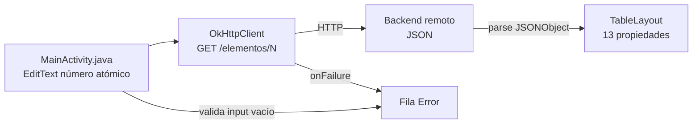

# Tabla Periódica - Aplicación Android

Aplicación Android (Java) que permite ingresar un número atómico y obtener información detallada del elemento químico correspondiente desde un backend remoto, mostrándola en un `TableLayout` de dos columnas.

[](https://github.com/bi0punk/Android101/actions/workflows/ci.yml)
[](LICENSE)


## Contenido

- [Características](#características)
- [Arquitectura](#arquitectura)
- [Stack](#stack)
- [Estructura del repositorio](#estructura-del-repositorio)
- [Instalación](#instalación)
- [Uso](#uso)
- [Tests / CI](#tests--ci)
- [Roadmap](#roadmap)
- [Licencia](#licencia)

## Características

- Entrada de un número atómico para buscar el elemento correspondiente.
- Solicitud HTTP a un servidor para obtener la información del elemento químico.
- Visualización de datos en una tabla de dos columnas (propiedad / valor) con `TableLayout`.
- Interfaz sencilla con diseño responsivo (`RelativeLayout`).

## Arquitectura



Detalle del flujo: la app convierte el número ingresado en la URL `http://YOUR_SERVER_IP:8000/elementos/{N}`, procesa la respuesta JSON (name, symbol, atomic_number, mass, exact_mass, ionization, electron_affinity, electronegativity, covalent_radius, van_der_waals_radius, melting_point, boiling_point, family) y puebla la tabla; sin backend disponible muestra una fila de error.

## Stack

- **Lenguaje**: Java (source/target Java 8)
- **Framework de red**: OkHttp 4.9.3
- **Diseño de UI**: XML con `RelativeLayout` y `TableLayout`
- **Backend**: servidor externo que responde JSON (`/elementos/{N}`)
- **Build**: Gradle con version catalog (`gradle/libs.versions.toml`), minSdk 23 / targetSdk 34
- **Testing**: JUnit (unit) + Espresso (instrumentado)

## Estructura del repositorio

```
Android101/
├── build.gradle
├── settings.gradle
├── gradle.properties
├── gradle/
│   ├── libs.versions.toml
│   └── wrapper/
├── gradlew / gradlew.bat
├── app/
│   ├── build.gradle
│   ├── proguard-rules.pro
│   └── src/
│       ├── main/
│       │   ├── AndroidManifest.xml
│       │   ├── java/com/example/tablaperiodica/MainActivity.java
│       │   └── res/ (layouts, drawables, values, mipmap…)
│       ├── test/java/.../ExampleUnitTest.java
│       └── androidTest/java/.../ExampleInstrumentedTest.java
└── .github/workflows/ci.yml
```

## Instalación

Requisitos: Android Studio (o JDK en CLI), dispositivo Android o emulador.

```bash
git clone https://github.com/bi0punk/Android101
cd Android101
```

## Uso

Abrir en Android Studio o compilar desde CLI:

```bash
./gradlew assembleDebug
```

El APK debug queda en `app/build/outputs/apk/debug/`. Antes de ejecutar, edita la URL del backend en `MainActivity.java` (`http://YOUR_SERVER_IP:8000/`).

## Tests / CI

```bash
./gradlew test              # unit tests
./gradlew connectedCheck    # instrumented tests (requiere dispositivo/emulador)
```

Hay un test instrumentado de ejemplo en `app/src/androidTest/`.

CI: GitHub Actions (`.github/workflows/ci.yml`) con Temurin JDK 17 + `setup-android`: valida el wrapper Gradle, `./gradlew assembleDebug` y `./gradlew test`.

## Roadmap

- [x] Búsqueda por número atómico con respuesta en tabla
- [x] Build de APK debug en CI
- [ ] Tests unitarios reales de la lógica de parseo
- [ ] Selección de backend configurable (sin hardcode)

Limitación: la app depende de un servidor backend externo para los datos; sin él no devuelve información.

## Licencia

MIT — ver [LICENSE](LICENSE).